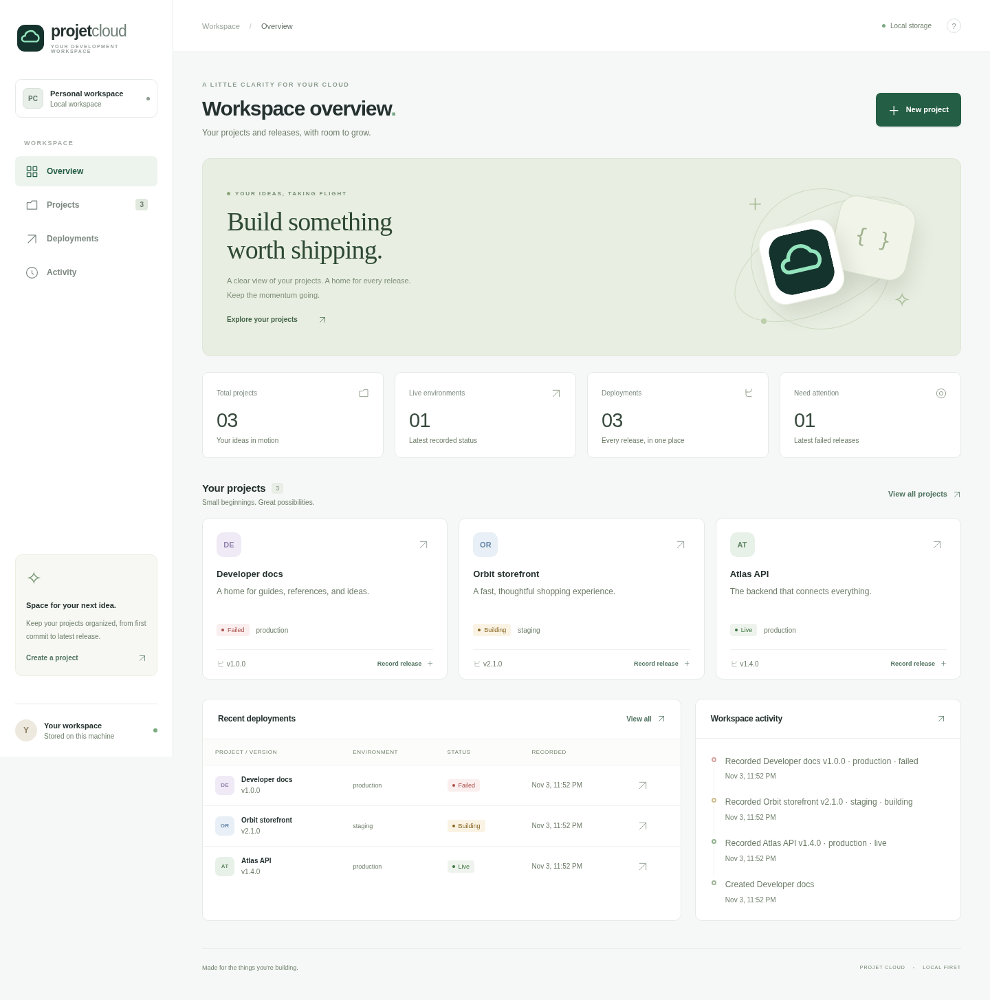

# Projet Cloud

A local-first dashboard for your projects and deployment history. A responsive interface, persistent SQLite storage, a JSON API, and no external services or runtime dependencies.



## Run locally

Install **Node.js 24 or later** (`.nvmrc` selects Node 24), then run:

```sh
npm ci
npm start
```

Open the app on port **3000** in your browser. Use `npm run dev` for server auto-restart during development. The frontend is plain HTML, CSS, and JavaScript; reload the page after frontend changes. No build step or credentials are required.

The workspace starts empty. Create a project or choose **Explore with example data** to try three clearly marked demonstration releases. Example data is optional and can only be loaded when there are no projects.

## What it does

- Create, edit, search, and delete projects, including an optional HTTPS repository link.
- Record release versions, environments, notes, and statuses: live, building, or failed.
- Update release statuses and filter deployment history by project, version, note, or environment.
- See live environments and failures based on the **latest release per project and environment**, rather than counting historical failures as current incidents.
- Follow a persisted activity timeline. Deleting a project deletes its deployments but retains the deletion event.
- Use keyboard-accessible dialogs and navigation on mobile and desktop.

This is a **deployment tracker**, not a deployment engine or infrastructure monitor. Statuses are entered manually. There are no cloud provider integrations, automatic builds, or background status checks.

## Configuration and storage

| Variable   | Default     | Purpose                                                                               |
| ---------- | ----------- | ------------------------------------------------------------------------------------- |
| `HOST`     | `127.0.0.1` | Interface to bind; use `0.0.0.0` only when needed for a container or trusted network. |
| `PORT`     | `3000`      | HTTP port.                                                                            |
| `DATA_DIR` | `./data`    | SQLite directory, relative to the working directory unless absolute.                  |

The server creates `data/cloudboard.sqlite` on first run. The database and SQLite journal files are ignored by Git. Restarting the app preserves data. For a simple consistent backup, stop the app and copy the entire data directory; restore it before restarting. Do not share or commit your database.

The app has **no authentication or multi-user isolation**. It binds to loopback by default and rejects cross-origin writes. Add authentication, authorization, and HTTPS before exposing it publicly. Repository URLs are stored as links; the server never fetches them. No credentials belong in project fields.

## Validation

```sh
npm run check
npm test
```

The Node test runner exercises HTTP requests against isolated temporary databases: CRUD, persistence across restarts, deployment summaries, input validation, cross-origin protection, example data, and static serving. Tests never touch the development database. CI runs the same checks on Node 24.

## Optional Docker workflow

```sh
docker compose up --build -d
docker compose logs app
docker compose down
```

The container runs as the unprivileged `node` user and has a health check. Port 3000 is published to loopback only. If that port is busy, use `APP_PORT=3001 docker compose up --build -d`. A named volume retains data across container recreation; `docker compose down -v` deliberately deletes it.

## API

All responses are JSON. POST and PATCH require `Content-Type: application/json`.

| Method | Path                   | Purpose                                                                                |
| ------ | ---------------------- | -------------------------------------------------------------------------------------- |
| GET    | `/api/health`          | Check the server and SQLite access.                                                    |
| GET    | `/api/dashboard`       | Projects, deployments, summary, and last 40 activity events.                           |
| POST   | `/api/projects`        | Create `{name, description?, repository?, color?}`. Colors: mint, blue, violet, amber. |
| PATCH  | `/api/projects/:id`    | Edit any project field.                                                                |
| DELETE | `/api/projects/:id`    | Delete a project and its deployment history.                                           |
| POST   | `/api/deployments`     | Record `{project_id, version, environment, status, note?}`.                            |
| PATCH  | `/api/deployments/:id` | Update `{status}`.                                                                     |
| POST   | `/api/demo`            | Load example data into an empty workspace; send `{}`.                                  |

Environments: `production`, `staging`, `development`. Statuses: `live`, `building`, `failed`. Validation errors return 400; missing records return 404. Fields have length limits, request bodies are limited to 16 KiB, and SQL queries use parameters.

## Project layout

```text
src/server.js       HTTP server, API routing, static assets
src/store.js        SQLite schema, validation, project and deployment logic
public/             Responsive browser application
test/app.test.js    HTTP integration tests
```
