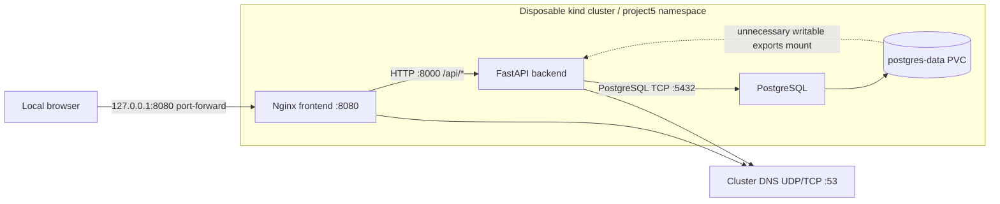

# Project 5 — Kubernetes Defense-in-Depth

**Phase 2 is complete:** eight baseline security scenarios were measured, with
the threat matrix, actual effects, negative controls and blast-radius analysis in
the [security assessment](evidence/v1/SECURITY-ASSESSMENT.md). The application
and insecure manifests are unchanged. The disposable cluster was deleted after
validation at the user's request; recreate it with the deployment steps below.

The [Phase 1 handoff](evidence/v1/README.md) preserves the earlier functional,
persistence and browser validation. The approved baseline is preserved on branch
`v1-insecure` with the annotated tag `v1-insecure`. Branch `v2-secured` starts
from that same baseline commit; security implementation has not begun.

Phase 1 builds a functional, deliberately insecure, **local-only** inventory
application. All records, payroll fixtures, and credentials are synthetic.
Secured implementation requires separate approval. Phase 2 security evidence is
separate from the earlier functionality checks under
[`evidence/v1/`](evidence/v1/).

This project lives in `devsecops-project5/` to preserve the parent repository's
pre-existing deletions of an unrelated Node.js dashboard. No earlier files were
restored, removed, committed, or tagged by this implementation.

## Architecture and communication

One single-node kind cluster, `project5-lab`, contains one application namespace,
`project5`. Three one-replica Deployments provide Nginx, FastAPI, and PostgreSQL.
The baseline deliberately collapses the web, application, and data trust
boundaries into that namespace. Infrastructure stays in its normal system
namespaces. Later phases can separate the application and data responsibilities.



| Source → destination | Required flow | Purpose |
| --- | --- | --- |
| Local browser → frontend | HTTP, `127.0.0.1:8080` | Static UI and same-origin API requests through port-forward |
| Frontend → backend | TCP 8000, `/api/*` | Nginx reverse proxy; browser never needs a backend port-forward |
| Backend → PostgreSQL | TCP 5432 | Parameterized CRUD queries |
| Frontend/backend → cluster DNS | UDP/TCP 53 | Resolve `backend` and `postgres` Service names |
| Kubelet → workload health endpoints | HTTP 8080/8000 or database exec probes | Readiness/liveness/startup |

No workload needs the Kubernetes API. Their mounted tokens and permissions are
intentional baseline weaknesses. PostgreSQL does not need outbound application
connections. These required flows describe the intended architecture; the
baseline does **not** restrict additional traffic.

The cluster API binds to `127.0.0.1`, all three Services are ClusterIP, and there
are no Ingresses, NodePorts, LoadBalancers, published application container ports,
or host-directory mounts. Use only the loopback port-forward below. kind nodes
are privileged Docker containers by design, so this remains a disposable lab
with outbound networking, not a hardened isolation boundary or an air gap.

## Prerequisites and pinned inputs

- Docker daemon access, kind, Bash, curl, sha256sum, and Python 3 for the checks.
- Tested kind CLI: v0.31.0; Docker Engine: 28.5.2.
- Kubernetes node: v1.35.0, pinned by digest in `scripts/lab.sh`.
- kubectl v1.35.0 is copied from **this lab node** to `.lab/bin/` on first use
  to avoid the host's v1.33 client/server version skew.
- Calico v3.33.0 is the sole CNI. The official manifest URL and SHA-256 are
  pinned in `scripts/lab.sh`; the downloaded file stays in ignored `.lab/cache/`.
  It is installed for native NetworkPolicy support. Phase 2 verified ingress
  enforcement with a temporary policy selecting only disposable test fixtures;
  application traffic remains unrestricted. Egress deny enforcement remains
  untested until a later approved phase.
- Python 3.13.9, Nginx 1.28.0, and PostgreSQL 17.6 images are digest-pinned.
  PostgreSQL is pulled by digest in the script and loaded as the local alias
  `project5-postgres:17.6` with `imagePullPolicy: Never`, since Docker archive
  imports do not preserve upstream multi-architecture repository digests.
  Backend direct dependencies are in `requirements.txt`; resolved transitive
  versions used by Docker are in `requirements.lock`. No frontend build system.

The host needs enough resources for one control plane and three small workloads.
Image pulls require internet access; nothing is published to an external service.

## Deploy and use

From the parent repository:

```sh
cd devsecops-project5
bash scripts/lab.sh up
bash scripts/lab.sh status
```

The script creates only `project5-lab`, verifies its node label, Docker kind
label, and loopback API endpoint, builds/loads local images, installs Calico, and
applies `k8s/base`. It always passes its own `.lab/kubeconfig` and explicit
context. It never uses or edits `~/.kube/config` or another cluster. Namespace
and workload changes must be made only through this dedicated lab context.

In a terminal kept open:

```sh
bash scripts/lab.sh forward
```

Open <http://127.0.0.1:8080>. Add, edit, refresh, and delete fictional inventory
items. Three demo items are seeded once per new database. No authentication is
implemented; this is a local demonstration application.

For subsequent source changes, rebuild and load images, then explicitly recreate
the changed workloads because their local `phase1` tags are fixed:

```sh
bash scripts/lab.sh build
bash scripts/lab.sh deploy
bash scripts/lab.sh kubectl -n project5 rollout restart deployment/backend deployment/frontend
bash scripts/lab.sh kubectl -n project5 rollout status deployment/backend --timeout=180s
bash scripts/lab.sh kubectl -n project5 rollout status deployment/frontend --timeout=180s
```

`cluster`, `build`, and `deploy` can also run separately when diagnosing setup.
No security hardening or advanced tools are installed by these commands.

## Functional validation

With the frontend port-forward active:

```sh
python3 tests/functional.py --persistence
bash scripts/lab.sh status
```

The standard-library test checks static assets, frontend→backend→database
communication, create/read/update/delete, duplicate SKU handling, quantity
validation, and missing-record responses. With `--persistence`, it creates a
temporary item, replaces the PostgreSQL Pod, verifies its UID changed and the
same PVC/PV retained the exact item, replaces the backend Pod, verifies the item
again, then deletes the temporary record. Only this disposable lab is touched.
Without the flag, no workloads are restarted.

Optional UI validation uses Selenium, Chromium, ChromeDriver, and Xvfb
(already present in the implementation environment; not application
dependencies). Use matching Chromium/ChromeDriver versions:

```sh
xvfb-run -a -s '-screen 0 1280x1100x24 -nolisten tcp' python3 tests/browser.py 2>&1 | tee evidence/v1/browser.log
```

It checks browser create/edit/delete, persistence on reload, displayed errors,
and mobile layout, and saves a screenshot to `evidence/v1/frontend.png`.

Health endpoints: backend `/health/live` checks the process, `/health/ready`
checks a database connection. Nginx `/health/live` checks static serving.
Kubernetes probes exercise these; the CRUD checks also exercise the actual
database schema. FastAPI API documentation is internal at backend `/docs`.
The backend waits five seconds after readiness before a rollout is considered
available, and allows ten seconds for endpoint removal before shutting down.
This avoids routing requests to a stopping process during local Pod replacement;
the single database replica still has expected downtime during its restart.

| Method | Backend path | Behavior |
| --- | --- | --- |
| GET | `/api/items` | List items |
| GET | `/api/items/{id}` | Read one item; 404 if absent |
| POST | `/api/items` | Create; 201, 409 on duplicate SKU |
| PUT | `/api/items/{id}` | Replace all four fields; 404 or 409 when appropriate |
| DELETE | `/api/items/{id}` | Delete; 204 or 404 |

JSON write body: `{"sku":"DEMO-004","name":"Demo dock","quantity":4,"location":"Fictional office C"}`.
Invalid bodies return 422. Queries use parameters and the UI inserts record
values with `textContent`; application injection flaws are unnecessary for the
Kubernetes threat demonstrations.

## Storage

`postgres-data` requests 512Mi, `ReadWriteOnce`, from kind's `standard`
StorageClass (`rancher.io/local-path`, `WaitForFirstConsumer`, reclaim `Delete`).
The backend and database can mount this RWO claim concurrently on the same node:
RWO restricts nodes, not individual Pods. No application manifest uses hostPath.
The provisioner's PV is backed by a directory **inside the disposable kind
node**, not a sensitive host directory. This local provisioner does not promise
hard per-PVC capacity quotas; 512Mi is the requested capacity.

PostgreSQL stores PGDATA in `pgdata/`, with its normal database permissions.
A separate `exports/` directory on the same PVC contains only
`fictional-payroll.csv`. An init container sets that directory to 0777 and the
fixture to 0666. The backend unnecessarily mounts that subdirectory read/write
at `/lab-shared`. Nothing needs this export to serve inventory requests.

Pod replacement retains the PVC and data. Deleting the namespace/PVC or kind
cluster can destroy it; this is not a backup, encryption, availability, or
disaster-recovery mechanism. PVCs do not provide per-container authorization
and should not be treated as a security boundary by themselves.

## Deliberate baseline weaknesses and planned measurements

This table preserves the **Phase 1 test plan**. Actual Phase 2 measurements,
including limits on what was demonstrated, are in the
[security assessment](evidence/v1/SECURITY-ASSESSMENT.md). These objectives alone
are not evidence of successful exploitation.

| ID | Threat / intentional weakness | Affected component | Phase 2 measurement objective |
| --- | --- | --- | --- |
| W01 | Excessive namespace Role grants secret access and workload/PVC operations | Shared ServiceAccount in all three workloads | Compare authorization checks and actual access to a synthetic Secret, with identity clearly recorded |
| W02 | Unnecessary automatic Kubernetes API tokens | All workloads | Confirm token presence and controlled authenticated API request; distinguish reachability from authorization |
| W03 | No NetworkPolicy; web/app/data in one namespace | Application network | Compare required service connections with an unauthorized frontend→database connection |
| W04 | Root web processes, allowPrivilegeEscalation true; no explicit capability drop, seccomp or read-only root | Backend, Nginx, export init | Record actual UID, capabilities and runtime restrictions; do not infer host compromise or successful escalation |
| W05 | Pod Security Admission `enforce: privileged` | Application namespace | Server-side dry-run a dangerous Pod configuration, without launching privileged code or host mounts |
| W06 | Unnecessary PVC export mount and 0777/0666 synthetic export permissions | Backend and database PVC | Read/write a disposable synthetic fixture from an unintended workload identity, restore it, assess mounted paths and permissions |
| W07 | Shared namespace and identity collapse responsibility boundaries | All app tiers | Measure namespace-scoped API/network/storage reach; no cluster-admin binding is introduced |

The Role is broad **only within `project5`**. This is still dangerous: combined
with permissive admission, Pod-creation rights may enable access beyond that
namespace. This is a risk to analyze later, not proof of node access. No
privileged application containers, host namespace settings, Docker socket
mounts, host credentials, or sensitive host paths are deployed for Phase 1.
Phase 2 demonstrated controlled API access, lateral exec, synthetic data
read/write effects and a conditional seeded setuid transition. No node or host
compromise was demonstrated; see the assessment for the exact preconditions.

The public demo database password is intentional and carries no real secret.
The application uses the demonstration database owner's account, not a
production least-privilege SQL account. A compromised backend will necessarily
retain some authorized application data access even after Kubernetes hardening;
future analysis must distinguish this from unauthorized infrastructure access.

## Repository and phase boundaries

The release includes Project 5 source, manifests, reusable tests, documentation,
and curated validation evidence. `.lab/`, kubeconfigs, real credential files,
caches, runtime files, and local diagnostic logs are excluded. Public synthetic
demo values in `k8s/base/config.yaml` and synthetic test canaries are fixtures,
not live credentials. The [release audit](evidence/v1/RELEASE-AUDIT.json) records
the included file hashes and credential checks.

Use fully qualified refs when inspecting the branch and tag with the same name:

```sh
git log --oneline --decorate refs/heads/v1-insecure
git show refs/tags/v1-insecure
git rev-parse 'refs/tags/v1-insecure^{commit}'
```

```text
devsecops-project5/
├── app/{frontend,backend}/    Application source and Dockerfiles
├── k8s/base/                Insecure baseline manifests
├── k8s/kind.yaml            Isolated single-node cluster configuration
├── k8s/security/            Future phases only
├── scripts/lab.sh           Reproducible, guarded local lab operations
├── tests/                   Functional checks
│   └── security/            Future reusable baseline/retest checks
├── evidence/{v1,v2}/        Observed outputs, with v2 reserved
└── README.md
```

`.lab/` is ignored because it contains the admin kubeconfig, binary, and download
cache. Never commit kubeconfigs or ServiceAccount tokens as evidence.

Phases 1 and 2 and the approved Git baseline freeze are complete. The next
implementation work is Phase 4 native security, after approval.
Phase 4 applies native protections, Phase 5 justifies selected advanced tools,
and later phases retest and compare blast radius. No security fixes have been
applied to the baseline or its initial `v2-secured` branch.

When finished with the lab, explicitly deleting **only this named cluster**
discards its resources and PVC data:

```sh
kind delete cluster --name project5-lab --kubeconfig .lab/kubeconfig
```

## Reference decisions

- [kind configuration](https://kind.sigs.k8s.io/docs/user/configuration/): loopback API binding, replacing the default CNI, no extra host mounts.
- [Calico on kind](https://docs.tigera.io/calico/latest/getting-started/kubernetes/kind): NetworkPolicy-capable networking. The downloaded v3.33.0 manifest is checked against the pinned checksum rather than a moving `latest` URL.
- [Kubernetes persistent volumes](https://kubernetes.io/docs/concepts/storage/persistent-volumes/): access modes and storage lifecycle.
