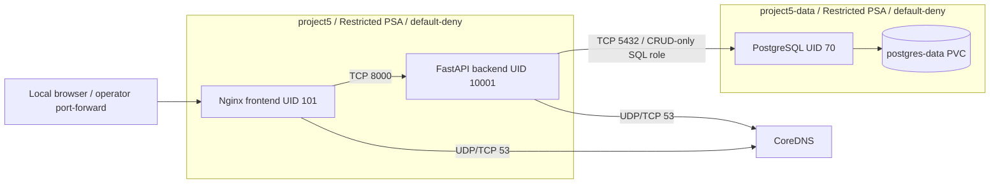

# Project 5 — Kubernetes Defense-in-Depth

This `v2-secured` working tree implements native Kubernetes hardening plus the
validated Kyverno admission policies. The approved insecure source and evidence
remain at annotated tag `v1-insecure` (commit `aeb8e9d`). V1 results are
preserved in [the Phase 2 assessment](evidence/v1/SECURITY-ASSESSMENT.md).
Native validation and the eight-scenario comparison belong in
[evidence/v2/native](evidence/v2/native/). The final advanced assessment is in
[evidence/v2/advanced](evidence/v2/advanced/).

The application still has the same Nginx frontend, FastAPI backend, PostgreSQL
persistence, inventory UI and CRUD API. All data and passwords are public,
synthetic lab fixtures. This is a disposable local demonstration, not a
production deployment. The 17 unrelated deletions in the parent repository
must remain untouched.

## Native deployment



Three dedicated, tokenless ServiceAccounts have no application API permissions.
Both namespaces enforce Restricted Pod Security v1.35. Containers drop all Linux
capabilities, disable privilege escalation, use RuntimeDefault seccomp and
read-only root filesystems; temporary directories are explicit emptyDirs.
NetworkPolicies allow only the illustrated application connections and DNS.
The frontend remains reachable through the trusted loopback operator tunnel.
See [control details and limits](k8s/security/README.md).

Prerequisites: Docker access, kind v0.31.0, Bash, Python 3, curl and sha256sum.
The script uses its own ignored `.lab/kubeconfig`, context kind-project5-lab,
and a kubectl v1.35 copied from that node. It guards the Docker cluster label,
node label and loopback API endpoint. It never targets a personal kubeconfig.
Kubernetes v1.35, Calico v3.33, Python 3.13.9, Nginx 1.28 and PostgreSQL 17.6
retain the V1 pinned inputs; the existing Docker base/CNI cache is reused.
No new cluster names or extra tools are required.

```sh
cd devsecops-project5
python3 scripts/validate_native.py
```

This is the reproducible validation lifecycle: create only project5-lab, load
cached CNI images sequentially, build/load native application images, deploy,
run functional checks including PostgreSQL/backend Pod replacement and PVC
persistence, test all eight security scenarios, rerun functionality, preserve
logs, then **delete project5-lab in a finally block**. Each attempt gets a new
evidence directory. Failed attempts remain evidence and return a failing exit.
The controlled setuid fixture image is used only by two disposable test Pods.
No packages are installed in running containers.

For interactive use, with responsibility to clean up afterward:

```sh
bash scripts/lab.sh up
bash scripts/lab.sh kyverno
bash scripts/lab.sh status
bash scripts/lab.sh forward
# Open http://127.0.0.1:8080 in the browser.
# In another terminal, after the tunnel is ready:
python3 tests/native_functional.py --persistence
# Stop the tunnel, then remove the disposable cluster:
bash scripts/lab.sh down
```

`bash scripts/lab.sh up` creates the single-node kind cluster, installs the
cached Calico manifest, builds and loads the local application images, and
deploys the native manifests. `bash scripts/lab.sh kyverno` then installs the
pinned cached Kyverno v1.19.2 release with server-side apply and applies
[the validated policies](k8s/advanced/kyverno-policies.yaml). The command
requires `.lab/cache/kyverno-v1.19.2-install.yaml`; it does not download a
release or recreate an existing cluster.

To exercise the retained Kyverno admission cases in an interactive cluster,
use the sanitized manifests/commands documented in
[the advanced reproduction guide](evidence/v2/advanced/REPRODUCTION.md) and
preserve the resulting admission output under `evidence/v2/advanced/kyverno/`.
The digest policy is Audit-only and must not be reported as prevention.

Use `PROJECT5_PORT=18080 bash scripts/lab.sh forward` for a different loopback
port and `PROJECT5_BASE=http://127.0.0.1:18080` for functional tests. The full
validator uses that port. Build/deploy use fixed `:native` local tags with
imagePullPolicy Never. After source edits, rebuild/load and explicitly restart
the relevant Deployment. `cluster`, `build`, `deploy` and guarded `kubectl`
subcommands remain available for diagnostics.

## Automated validation and cleanup

The automated native validator is the reproducible, destructive validation
workflow:

```sh
python3 scripts/validate_native.py
```

It creates only `project5-lab`, runs the pre/post functional checks and the
eight native security scenarios, preserves sanitized evidence, and deletes the
cluster in a `finally` block on success, failure, or interruption. The final
Kyverno integration and targeted digest-audit validation passed the functional
checks, all eight native scenarios, the corrected regression integrity check,
and all Kyverno admission/reporting checks. The digest workload was accepted
in Audit mode and its matching Pod-scoped PolicyReport recorded the expected
failure before the Pod was deleted. Project 5 meets the required integration
criteria.

The native security runner defaults to migration integrity (`V1 -> V2`), where
the protected runtime configuration must change. For an already-secured
regression (`V2 -> V2`), invoke the security runner with
`--integrity-mode regression`; this requires the protected configuration to
remain unchanged and still runs all eight security scenarios.

For a disposable automated Kyverno admission check, start from a clean
`project5-lab`, run `bash scripts/lab.sh up` followed by
`bash scripts/lab.sh kyverno`, execute only the retained Kyverno scenarios
from the reproduction guide, and delete the cluster immediately afterward:

```sh
trap 'bash scripts/lab.sh down || true' EXIT INT TERM
bash scripts/lab.sh up
bash scripts/lab.sh kyverno
# Run the sanitized Kyverno cases from evidence/v2/advanced/REPRODUCTION.md.
# Save only concise results under evidence/v2/advanced/kyverno/.
```

This shell workflow is intentionally separate from `validate_native.py`:
Kyverno's approved-image and resource rules can affect future test fixtures,
and no combined post-Kyverno regression result is claimed without executing
one. Always verify cleanup with:

```sh
kind get clusters
docker ps -a --filter label=io.x-k8s.kind.cluster=project5-lab
```

The final architecture does not include Cilium, Linkerd, Falco, or Tetragon.

## Application and database

The UI retains create/edit/delete, validation and refresh behavior. API routes:

| Method | Path | Response |
| --- | --- | --- |
| GET | /api/items | List inventory |
| GET | /api/items/{id} | Item or 404 |
| POST | /api/items | 201; duplicate SKU 409; invalid body 422 |
| PUT | /api/items/{id} | Updated item; 404/409/422 as applicable |
| DELETE | /api/items/{id} | 204 or 404 |

Write JSON: `{"sku":"DEMO-004","name":"Demo dock","quantity":4,"location":"Fictional office C"}`.
Parameterized queries and the original UI are preserved. Backend live/ready
health endpoints and Nginx live checks remain configured. One replica means
expected database downtime during replacement; this is not high availability.

On a **fresh PVC**, PostgreSQL's trusted bootstrap creates the original schema
and three seed records, transfers ownership to a NOLOGIN role and grants
inventory_app only CONNECT, schema USAGE, inventory SELECT/INSERT/UPDATE/DELETE
and identity-sequence USAGE. The backend starts with a schema-readiness query;
it cannot run migrations or reseed records. The bootstrap admin is available
only through local peer authentication; TCP HBA rules accept only the app role
on the inventory database. The backend never receives the admin Secret.

This is a fresh disposable-cluster deployment, **not an in-place V1 database
migration**. A pre-existing database would require an authorized migration;
the initialization directory is not rerun on an initialized PGDATA.

The 512Mi RWO local-path PVC is in project5-data. PGDATA and exports directories
are 0700; the synthetic export is 0600, owned by UID 70. The backend has no PVC
mount. Pod replacement preserves data; deleting the cluster destroys local
storage. RWO is a node attachment rule, not per-Pod authorization, a quota,
backup, encryption or recovery facility.

## Validation and limits

Original `tests/security/baseline.py`, `probe.py`, `tests/functional.py`,
`tests/browser.py` and evidence/v1 remain unchanged. Native expectations are
separate in `tests/security/native.py` and `native_probe.py`. The functional
adapter only redirects PostgreSQL/PVC commands to project5-data and supports
the selected loopback port; original functional assertions are reused.

Security testing assumes administrator-supplied container execution to model a
foothold. It does not exploit an application bug or demonstrate a host escape.
Dangerous admission specifications are the original 14 V1 fixtures, sent as
server dry-runs under operator credentials to isolate PSA from RBAC. No
privileged or host-access Pod is launched. A seeded setuid positive/negative
control has an explicit already-root image-build precondition.

Remaining limits include unauthenticated CRUD over the permitted frontend path,
no application/DB TLS, plaintext synthetic Secret values (no at-rest encryption),
allowed DNS, trusted cluster/node administrators, same-identity Pod spoofing by
authorized Pod creators, permitted-connection data abuse, PSA's writable-root
admission gap and local storage availability. Native containment reduces the
measured blast radius; it does not establish tenant isolation or protect all
data after an authorized application/database process compromise.
