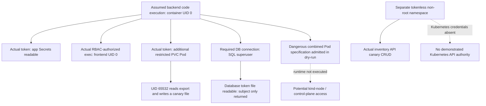

# Phase 2 — Threat model and insecure-baseline security assessment

**Status: complete; review required before Phase 3.**

This assessment records the state at the end of Phase 2. The subsequently
approved Git baseline freeze is documented in the project README and
[release audit](RELEASE-AUDIT.json). Its findings and raw retained evidence are
unchanged; no workload hardening was part of release packaging.

The baseline has a large application-namespace blast radius. An assumed backend
compromise starts as container UID 0, can use its mounted token to read Secrets
and create workloads, and can execute commands in the frontend through excessive
RBAC. A non-root, tokenless Pod in another namespace could also manipulate a
synthetic inventory record through the unauthenticated backend API. Export
permissions allowed UID 65532 to read and modify synthetic payroll data.

Valid privileged and host-access Pod specifications were accepted in server-side
dry-run. This establishes an admission gap and a **potentially critical node
escalation path**, not a demonstrated node or host compromise. No dangerous Pod
was launched. The controlled setuid transition described below was confined to
a seeded container-local helper and has an explicit already-root setup
precondition.

No application security fixes, architecture changes, or advanced security tools
were introduced. The cluster was **deleted after all final checks**, as requested
to free resources. The application is therefore not currently running.

## Evidence and environment

The authoritative run is **336a65ecfb**, executed on **2026-11-09, 14:12:55–14:14:09
America/New_York** (19:12:55–19:14:09 UTC).

| Artifact | Contents |
| --- | --- |
| [Final results](phase2-20261109T191255Z-336a65ecfb/results.json) | All eight scenarios, no harness errors; 15 expected baseline observations matched |
| [Command transcript](phase2-20261109T191255Z-336a65ecfb/commands.jsonl) | Exact argv, actor/transport, exit codes, stdout/stderr and stdin source hashes |
| [Environment](phase2-20261109T191255Z-336a65ecfb/environment.json) | Cluster version, CNI, namespace, Role, storage, initial state and source hashes |
| [Fixtures](phase2-20261109T191255Z-336a65ecfb/fixtures.json) | Actual temporary resources and exact dry-run-only specifications |
| [Integrity](phase2-20261109T191255Z-336a65ecfb/integrity.json) | Unchanged source, application resource definitions/Pod identities and existing database rows |
| [Fixture cleanup](phase2-20261109T191255Z-336a65ecfb/cleanup.json) | Successful removal of the extra PVC Pod, canary Secret and disposable namespace |
| [Functional preflight](phase2-functional-before.log), [postflight](phase2-functional-after.log) | Existing frontend/assets, CRUD and input-validation suite passed before and after security tests |
| [Final resources](phase2-final-resources.log) | Three Deployments ready and PVC Bound before teardown |
| [Cluster deletion](phase2-cluster-cleanup.log) | Named kind node deleted; zero remaining `project5-lab` containers |
| [Evidence checks](phase2-evidence-checks.json) | Matching test-source hashes, no raw JWT strings in Phase 2 evidence, personal kubeconfig unchanged |
| [Run console](phase2-run.log) | Initial harness failure and final successful measurements; local setup diagnostics are excluded from the Git release |

Tested: Kubernetes **v1.35.0**, kind **v0.31.0**, Calico **v3.33.0**, three
Deployments in namespace `project5`, and one kind control-plane node. The
application images remained the Phase 1 images: backend `e3a2e4ebea20…`, frontend
`3cbe8fcd58dc…`, PostgreSQL `d741b3768746…`.

The earlier cluster was removed during setup to conserve resources. Testing
therefore used a fresh deployment of the unchanged Phase 1 source, not the old
Phase 1 PVC. The tested PVC UID was
`641ec459-4e2f-470f-b3d2-2d0a82aca567`, bound to
`pvc-641ec459-4e2f-470f-b3d2-2d0a82aca567`. Earlier Phase 1 evidence remains intact.

**A matched insecure-baseline expectation is a successful measurement of a
weakness, not a security pass.** The results below are actual observations.

## Threat model

### Assets, entry assumptions and boundaries

Assets are synthetic inventory records, the fictional payroll export, the lab
database Secret, ServiceAccount credentials, workload definitions, the database
PVC, and availability/integrity of the local cluster.

The primary adversary is assumed to have code execution in the backend. An
administrator supplied probe code using `kubectl exec` to model that foothold;
the tests did **not** exploit an application vulnerability to obtain it. Probe
traffic then originated inside the real workload network/process context.
Secondary scenarios use a compromised frontend or a UID 65532, tokenless Pod in
a separately created disposable namespace.

Intended boundaries are:

1. Local browser → frontend, exposed only through a loopback port-forward.
2. Frontend → backend, limited by business purpose to inventory HTTP requests.
3. Backend → PostgreSQL, requiring database authentication and legitimate CRUD.
4. Workloads → Kubernetes API, for which this application has no business need.
5. Application tier → database/export storage, where the backend's export mount
   is unnecessary.
6. Application namespace → other namespaces; API authorization and network
   isolation must be assessed independently.
7. Containers → kind node/control plane → underlying VM/host. Container root is
   not itself proof that either outer boundary has been crossed.

Normal required flows remain browser→frontend, frontend→backend TCP 8000,
backend→PostgreSQL TCP 5432, and workload DNS resolution. Service discovery,
Secret environment injection and PVC mounting do not require these application
processes to hold broad Kubernetes API permissions.

### Threat matrix

`W01`–`W07` refer to the intentional weaknesses in the project README. Severity
rates impact **after the stated foothold**, not public exploitability or a
production incident. All affected data and resources belong to the local lab.

| ID | Threat / weakness | Expected impact | Controlled test | Actual baseline result | Evidence |
| --- | --- | --- | --- | --- | --- |
| T01 | Excessive namespace RBAC, W01/W02 | Secret disclosure, workload control, storage management | Impersonated authorization matrix plus real mounted-token API requests | Secret/PVC reads HTTP 200; Deployment patch dry-run 200; cross-namespace and anonymous Secret reads 403 | Final results `cases.T01` |
| T02 | Shared identity and unnecessary tokens, W02/W07 | Frontend inherits backend API authority; cross-workload execution | TLS-verified identity/Secret requests and actual impersonated `pods/exec` | Frontend/backend share the same API identity; frontend reads canary Secret; frontend exec runs as UID 0 | `cases.T02` |
| T03 | No NetworkPolicy, W03 | Unnecessary east-west and inter-namespace communication | Required/prohibited traffic and isolated CNI control | Frontend and foreign-namespace Pod reach PostgreSQL; backend reaches unnecessary destinations; CNI deny control works | `cases.T03` |
| T04 | Root, escalation enabled, capabilities, writable roots and no explicit seccomp, W04 | Increased container authority and weaker containment | Runtime inspection, reversible writes, raw socket creation, seeded setuid control | Web processes UID 0, NoNewPrivs 0, Seccomp 0; writes/raw socket succeed; seeded child becomes EUID 0 | `cases.T04` |
| T05 | Unnecessary export mount and weak permissions, W06/W01 | Unauthorized synthetic export reads/writes and PVC reuse | UID 65532 read/write/restore; real token creates restricted PVC Pod | Export modified and restored; extra non-root Pod reads export and writes its own temporary file | `cases.T05` |
| T06 | Permissive Pod Security namespace, W05/W01 | Dangerous workload admission; possible node-level expansion | Individual and combined dangerous Pod specs, server-side dry-run only | Valid privileged, host namespace, hostPath, root, capability and unconfined requests accepted; no dangerous Pod persisted | `cases.T06` |
| T07 | Collapsed trust boundaries and unauthenticated app API, W03/W07 | A foreign workload can manipulate inventory without Kubernetes credentials | Real CRUD on one synthetic canary from a tokenless, non-root test Pod | GET/POST/PUT/DELETE return 200/201/200/204; deleted canary subsequently 404 | `cases.T07` |
| T08 | Broad existing database account and projected token exposure | SQL authority extends into database-server filesystem credentials | Query actual role flags, rollback a temp table, project only token's public subject | `inventory` is SQL superuser with CREATEDB/CREATEROLE; server reads its own projected-token file | `cases.T08` |

T08 is a correlated database/application risk identified in the existing
baseline, not a new weakness installed for this phase.

## Findings and interpretation

### T01 — Excessive API authority: High

**Affected component:** `shared-workload` ServiceAccount and its namespace Role.
The application needs no Kubernetes API access; safe expectations are absence
of unnecessary credentials and denial of unnecessary resource operations.

The 14-entry authorization matrix allowed seven tested operations: get/list
Secrets, create Pods, create `pods/exec`, patch Deployments, and get/delete PVCs.
Subresources were checked with explicit `--subresource`, avoiding confusion with
an object named `exec` or `token`.

Using the backend's actual mounted token and verified cluster CA, the API
returned HTTP 200 for the canary Secret, `demo-database`, and the bound PVC.
Only Secret keys/hashes were retained. A merge-patch dry-run against the backend
Deployment returned 200 and the requested synthetic annotation; the real
Deployment remained unchanged.

Negative controls returned 403 for an anonymous request and for a request to an
existing canary Secret in the disposable other namespace. Authorization checks
also denied node/PV reads, namespace listing, RoleBinding creation, direct
ServiceAccount TokenRequest creation, and `kube-system` Secret reads.

**Impact/blast radius:** API confidentiality and workload control in `project5`.
This is permission exceeding business need, not an API authentication bypass.
PVC deletion is authorized but was not executed; no deletion/data-loss attack
was demonstrated. Direct cluster-admin access was not obtained. Denial of a
direct TokenRequest does not neutralize Pod-creation authority, because Pod
creation can result in additional automatically mounted credentials.

Kubernetes documents that workload creation can implicitly expose mounted
Secrets/storage and ServiceAccount authority. That is why namespace-scoped
permissions alone do not establish strong workload containment.
[Kubernetes RBAC guidance](https://kubernetes.io/docs/concepts/security/rbac-good-practices/)

### T02 — Shared identity and lateral execution: High

**Affected components:** frontend, backend and PostgreSQL. All three are
configured with `shared-workload` and have mounted tokens, although none needs
an API client for its application role.

Actual frontend and backend SelfSubjectReview requests identified both as
`system:serviceaccount:project5:shared-workload`. The frontend also successfully
read the canary Secret through a TLS-verified request; its response was hashed
inside the container. PostgreSQL had a token present; its server process ran as
UID 70. T08 separately verifies that the SQL server can read the token file's
public identity claim. PostgreSQL's token was not replayed over HTTP.

An actual API `pods/exec` request, using administrator impersonation of the same
workload identity and its standard groups, executed a harmless command in the
frontend and returned `SYNTHETIC-LATERAL-EXEC uid=0`. This is genuine
cross-workload command execution authorized by that identity. The client
transport used administrator impersonation; it was not an extracted-token exec
client inside the backend. T01/T05 independently validate real token use.

**Impact/blast radius:** frontend compromise would inherit the same excessive
API rights as backend compromise; backend identity can execute commands in the
frontend container. Shared identity prevents RBAC from expressing the tiers'
different responsibilities. No frontend exploit or host escape was attempted.

### T03 — Prohibited network communication: High

**Affected components:** application Pods and namespace network boundary. There
were no application NetworkPolicies before or after measurement.

Required frontend→backend readiness HTTP and backend→database connectivity
worked. PostgreSQL DNS resolved successfully. The following unnecessary paths
also worked:

- Frontend→PostgreSQL TCP 5432 returned PostgreSQL's `N` SSL-negotiation byte.
- A tokenless Pod in the disposable other namespace reached both the backend
  and PostgreSQL; the latter also returned `N`.
- Backend→frontend HTTP returned 200.
- Backend→the controlled HTTP destination in the disposable namespace returned
  200, demonstrating unnecessary outbound reachability to that destination.

The PostgreSQL byte establishes protocol reachability, **not SQL authentication
bypass or access to database records from the frontend**. No external services
or other projects were scanned. Internet-wide reachability was not tested.

**CNI control:** the same backend→test-target request returned 200 before a
fixture-only ingress deny, timed out twice while it existed, and returned 200
after its removal. The target Pod UID and response hash remained unchanged.
The policy selected only the disposable target; no application policy changed.
This verifies Calico's ingress NetworkPolicy enforcement in the tested path,
rather than attributing allowed traffic to a nonfunctional CNI. Egress deny
enforcement was not independently evaluated here.

Kubernetes describes an unisolated Pod's traffic as allowed in the absence of
selecting policies. The observed reachability and the fixture control are
consistent with that model.
[NetworkPolicy semantics](https://kubernetes.io/docs/concepts/services-networking/network-policies/)

### T04 — Weak runtime containment and conditional setuid transition: High

**Affected components:** backend and both Nginx master/worker processes.
Runtime observations confirmed UID 0, `NoNewPrivs: 0`, `Seccomp: 0` and zero
seccomp filters. This run therefore demonstrated actual absence of filtering,
not merely a missing manifest field.

Both web root filesystems accepted a uniquely named synthetic write; those
files were removed. The backend created and closed an ICMP raw socket without
sending any packets. Effective/bounding capabilities were
`00000000a80425fb`, including `NET_RAW`, `SETUID`, `SETGID`, `DAC_OVERRIDE`,
`MKNOD` and other default capabilities. `SYS_ADMIN` was not in the current
workloads' effective set. No spoofing, sniffing, syscall exploit or network
policy bypass was demonstrated.

**Controlled transition:** an already-root test process temporarily installed a
root-owned 4755 copy of the container's Python executable plus a mode-0600
synthetic canary. An ordinary child with real/effective UID 65532 could not read
the canary. Executing the seeded helper from the same real UID produced EUID 0
and read it successfully. The helper and canary were removed.

This demonstrates a container-local, exec-based privilege transition when such
a helper exists and NoNewPrivs is unset. **It does not show that an initially
unprivileged attacker could install the helper, that an existing helper was
exploitable, or that root was obtained on the node.** The assumed backend
foothold already starts as container root. Linux's NoNewPrivs mechanism is
specifically relevant to preventing new privileges through setuid/file-capability
execution; it is not a universal restriction on all privileged operations.
[Linux kernel documentation](https://docs.kernel.org/userspace-api/no_new_privs.html)

### T05 — Export exposure and PVC reuse: High

**Affected components:** `postgres-data`, the backend's unnecessary export mount,
and synthetic `fictional-payroll.csv`.

The directory was 0777 and the root-owned file 0666. A backend child running as
UID 65532 read the fixture and appended a run-specific synthetic marker. Its
hash changed, then the original bytes and mode were restored. Original and
restored SHA-256 were both
`054b058e4c24bc619591295acdeb2d1b4f5271fddbfa978ccea4578e3b23d072`.

The backend's real token then created a **restricted, non-root, tokenless** Pod
mounting the same PVC. An impersonated workload exec into that Pod, running as
UID 65532, read the export and created/deleted its own temporary file in the
exports directory. Backend, database and this Pod concurrently mounted the
claim on the same node. PVC reuse was demonstrated, not just authorized in a
configuration review.

The extra non-root Pod **could not list `pgdata/`**. Raw database files were not
read. The backend's existing subPath mount exposes exports, not the entire
database directory. The separate probe's full-claim mount and its successful
export access do not prove raw PGDATA disclosure.

**Impact/blast radius:** confidentiality/integrity of exports outside the
backend's business purpose, plus additional-workload access to a claim when
Pod creation is allowed. File ownership by root did not protect world-readable/
writable data. RWO constrains nodes, not a single Pod on that node, and is not a
per-workload authorization boundary.
[Persistent volume access modes](https://kubernetes.io/docs/concepts/storage/persistent-volumes/)

### T06 — Dangerous admission decisions: Potentially Critical

**Affected component:** namespace with `pod-security.kubernetes.io/enforce:
privileged`, combined with workload Pod-creation authority.

The actual workload token submitted 14 server-side dry-runs:

| Specification | HTTP result |
| --- | --- |
| Restricted-compatible control | 201 accepted |
| Privileged container with compatible escalation setting | 201 accepted |
| allowPrivilegeEscalation true | 201 accepted |
| SYS_ADMIN capability | 201 accepted |
| Unconfined seccomp | 201 accepted |
| Writable root filesystem | 201 accepted |
| Root UID / non-root requirement disabled | 201 accepted |
| hostNetwork, hostPID, hostIPC, each individually | 201 accepted for each |
| hostPath to a synthetic admission-only path | 201 accepted |
| Combined privileged + root + unconfined + host namespaces + synthetic hostPath | 201 accepted |
| Invalid string instead of boolean | 400 rejected |
| Contradictory privileged true / allowPrivilegeEscalation false | 422 rejected |

No name from these dry-runs appeared among persisted Pods. No host directory
was mounted, and no privileged or host-namespace container was executed. The
fake path `/project5-synthetic-admission-only` was never created or read.

**Impact/blast radius:** a valid combined specification passes API/admission
checks under the workload identity. Running an equivalent dangerous workload
could expand reach to the kind node and its control-plane resources, but that
runtime consequence was intentionally not tested. A dry-run response is not
proof of scheduling, successful container startup, host file access, or physical
host compromise. The malformed controls show core API validation still works;
the result does not mean every API request is accepted.

The Privileged Pod Security level permits configurations that more restrictive
levels constrain. Read-only root filesystems are a separate workload/policy
choice; Restricted Pod Security alone does not require that field. Server-side
dry-run traverses validation/admission without persisting the object.
[Pod Security Standards](https://kubernetes.io/docs/concepts/security/pod-security-standards/),
[API dry-run semantics](https://kubernetes.io/docs/reference/using-api/api-concepts/#dry-run)

### T07 — Namespace separation does not protect the app API: High

**Affected components:** application HTTP API and namespace trust boundary.

A separately created Pod used UID 65532, the default ServiceAccount, and
`automountServiceAccountToken:false`; the probe confirmed no token file. It
listed the three synthetic records, created its own `SEC-<run ID>` record,
changed its quantity, observed the change, deleted it, and received 404 afterward.
The corresponding statuses were 200, 201, 200, 200, 204 and 404.

**Impact/blast radius:** a foreign workload needs neither Kubernetes credentials
nor a database password to manipulate inventory through the exposed,
unauthenticated HTTP API. This is actual controlled application data
manipulation, not merely a successful TCP connect. Only the test's new record
was changed; existing rows were untouched.

The cross-namespace API Secret request in T01 was still denied. Kubernetes RBAC,
Pod networking, and application authorization are separate controls. Native
network restrictions can reduce who reaches the backend, but required frontend
and compromised-backend flows still need application/database authorization.

### T08 — Application database superuser reaches a projected credential: High

**Affected components:** existing `inventory` SQL account and PostgreSQL Pod.
Actual role inspection returned `superuser=true`, `create_database=true` and
`create_role=true`, plus SELECT/INSERT/UPDATE/DELETE privileges on inventory.
The same account wrote a temporary SQL table and rolled the transaction back.

Using that account, PostgreSQL successfully evaluated `pg_read_file` for its
own mounted ServiceAccount token and decoded **only the public `sub` claim
inside the database**. The returned value was
`system:serviceaccount:project5:shared-workload`. No raw token or signature was
returned, persisted or replayed from this SQL path.

**Impact/blast radius:** database credentials have authority beyond inventory
CRUD and can cross into the database server's filesystem where OS permissions
allow. Access to the complete credential could support further API access;
that end-to-end SQL-token replay was not performed. This is container-local
filesystem authority, not host filesystem access.

The database must retain some application DML authority. SQL superuser and
credential-file access are broader than that need; Kubernetes configuration
alone cannot enforce least-privilege SQL operations over a required database
connection.
[PostgreSQL role attributes](https://www.postgresql.org/docs/17/role-attributes.html),
[PostgreSQL file functions](https://www.postgresql.org/docs/17/functions-admin.html#FUNCTIONS-ADMIN-GENFILE)

## Baseline blast radius

The following table distinguishes reachability, authorization and actual effect.

| Target | Measured reach/authority after assumed backend compromise | Demonstrated effect / limit |
| --- | --- | --- |
| Backend container | UID 0, writable root, default capabilities, no seccomp/NoNewPrivs | Temporary writes and raw socket creation; no node escape |
| Frontend container | HTTP reachable; workload identity may use `pods/exec` | Harmless command actually ran as frontend UID 0 |
| App namespace Secrets | Actual token GET allowed | Canary and database Secret retrieved; only keys/hashes retained |
| Workload definitions | Pod creation and Deployment patch authorized | Restricted PVC Pod created; Deployment patch accepted only in dry-run |
| PVC exports | Existing unnecessary mount and extra Pod mount | UID 65532 read/write effects demonstrated and restored |
| Raw PGDATA | Extra non-root Pod mounts claim but cannot list PGDATA | No raw database file disclosure demonstrated; root remount is a separate untested path |
| Logical inventory data | Required authenticated DB connection with broad SQL role | Three records readable; synthetic API canary manipulated; existing-row digest preserved |
| PostgreSQL projected token file | SQL superuser can read it through server file function | Public subject extracted; no SQL-path token replay |
| Other namespaces over network | Controlled foreign namespace and its HTTP target reachable | Real cross-namespace HTTP/DB connectivity; no broad scan |
| Other namespaces over Kubernetes API | Tested Secret request denied | Namespace RBAC boundary held in this case |
| Node/PV/namespace-list APIs and RBAC binding creation | Authorization checks denied | No direct cluster-admin authority obtained |
| Kind node/control plane | Combined dangerous Pod dry-run accepted | Conditional node-level risk; no dangerous Pod executed |
| Physical host / unrelated projects / internet destinations | Not tested | No compromise, file access, or reachability claim |



The most consequential combination is **workload API credentials + broad Pod
creation + permissive admission**. A namespaced Role is not sufficient to rule
out node-level consequences. Conversely, seeing container root, a reachable
port or an accepted dry-run is insufficient to claim a host compromise.

## Controls and limits that remained effective

- API authentication/authorization rejected anonymous and cross-namespace Secret
  reads. The sampled cluster-scoped and RBAC-management operations were denied.
- PostgreSQL's main process ran as UID 70, and PGDATA directory permissions
  blocked the non-root probe's listing attempt.
- Existing workloads had no privileged flag, host namespaces or hostPath mount;
  their effective capabilities did not include SYS_ADMIN. Dangerous admission
  was tested without activating those settings.
- The CNI enforced the disposable ingress deny control. Application traffic was
  unrestricted because no application policy selected it, not because that
  control measurement found a broken CNI.
- Core API type/consistency validation rejected malformed objects. Functional
  duplicate, input and missing-record handling also remained operational.
- The application stayed local-only. No real credentials, sensitive host paths,
  production resources, existing-record tampering or destructive PVC deletion
  were used.

Coverage does not include application RCE discovery, existing-helper exploitation,
kernel escapes, external egress scans, malicious images, destructive availability
attacks, runtime detection effectiveness or advanced-control evaluation. No
secured-version comparison can be claimed yet.

## Reproduction and evidence integrity

From the repository's `devsecops-project5/` directory:

```sh
bash scripts/lab.sh up
# Keep this command active in another terminal:
bash scripts/lab.sh forward

python3 tests/functional.py
python3 tests/security/baseline.py --expect-baseline
python3 tests/functional.py

# Stop the forward and explicitly remove only this disposable cluster afterward:
kind delete cluster --name project5-lab --kubeconfig .lab/kubeconfig
```

The runner itself removes its uniquely labelled fixtures; it does not silently
delete the entire cluster. `--expect-baseline` checks insecure observations.
Omit it to collect observations without requiring vulnerable outcomes; namespace,
data namespace, ServiceAccount and PVC arguments support later reuse. A future
missing token/path, a genuine authorization denial and a transport error must
remain distinct. See [test procedure](../../tests/security/README.md).

The execution used existing images, cached the same three Calico images before
node creation, and loaded images sequentially. This reduced repeated downloads
after the lab had been removed. Cold image downloads previously caused a Calico
progress-deadline warning; the controller later became healthy without a
configuration change. An image import exited 137 while the lab container was
being removed. No out-of-memory cause was established. These were setup events,
not security findings.

To reproduce the cached-CNI startup used here, perform this **before** the `up`
command above on a new lab; then `up` installs the unchanged CNI manifest and
application normally:

```sh
for image in quay.io/calico/calico:v3.33.0 quay.io/calico/node:v3.33.0 quay.io/calico/third-party-cni-plugins:v3.33.0; do
  docker pull "$image"
done
kind create cluster --name project5-lab --image kindest/node@sha256:452d707d4862f52530247495d180205e029056831160e22870e37e3f6c1ac31f --config k8s/kind.yaml --kubeconfig .lab/kubeconfig --wait 0s
for image in quay.io/calico/calico:v3.33.0 quay.io/calico/node:v3.33.0 quay.io/calico/third-party-cni-plugins:v3.33.0; do
  kind load docker-image --name project5-lab "$image"
done
```

The [initial run](phase2-20261109T190750Z-27e45afdb4/results.json) is retained but
is not the authoritative complete run:

- Its T02 curl invocation used unsupported equals-style option syntax. Curl's
  diagnostic echoed a token-bearing argument; the output guard refused to
  write the record. The harness was corrected to supply headers through stdin
  and use supported option syntax. No raw JWT was persisted or shown
  unredacted. This was a test-harness correction, not an application fix.
- Its first privileged fixture contradicted itself by specifying privileged
  true with escalation false, producing core-validation HTTP 422. A valid
  privileged fixture was used in the final run, and the contradictory fixture
  was retained as an explicit negative control. The original response was not
  relabelled as successful security enforcement.

The final run has zero harness errors. All 21 existing application/manifests/lab
script files matched their pre-test hashes. Application definitions, namespace
policy state, Pod UIDs and image IDs were unchanged across the measurements.
The three existing database rows retained SHA-256
`16ab703b9d23830c0070316d125bd8400edf2c078de4bba01634f558c5c2c909`.
The security canary advanced the inventory sequence from 8 to 9 even after
deletion; that expected sequence side effect was recorded, not hidden. The
export's bytes and mode were restored; timestamps can reflect its controlled
write/restore.

The extra PVC Pod, canary Secret and disposable namespace were deleted using
their unique run label and UID checks. The temporary NetworkPolicy, setuid
helper, root-only canary and filesystem markers were removed. Functional
postflight passed, then the kind cluster was deleted. A final Docker check found
zero labelled lab containers, and the personal kubeconfig's content hash was
unchanged. Evidence scanning found no raw JWT-shaped strings in Phase 2 files.

## Review priorities and phase boundary

The evidence supports later evaluation of least-privilege identities/RBAC,
removal of unnecessary token mounts, enforced network allowlists, restricted
runtime contexts, admission restrictions and removal/protection of the export
mount. SQL superuser authority and unauthenticated application access are
separate residual risks over otherwise legitimate flows. These are assessment
priorities only; **no fixes or secured manifests were implemented**.

Phase 2 added the reusable [runner](../../tests/security/baseline.py),
[in-container probes](../../tests/security/probe.py), test documentation and this
assessment/evidence. Existing Phase 1 source and logs were preserved. No commit,
`v1-insecure` tag, advanced tools, native hardening or Phase 3 work was performed.
The next step, only after review/approval, is the Phase 3 baseline freeze.
